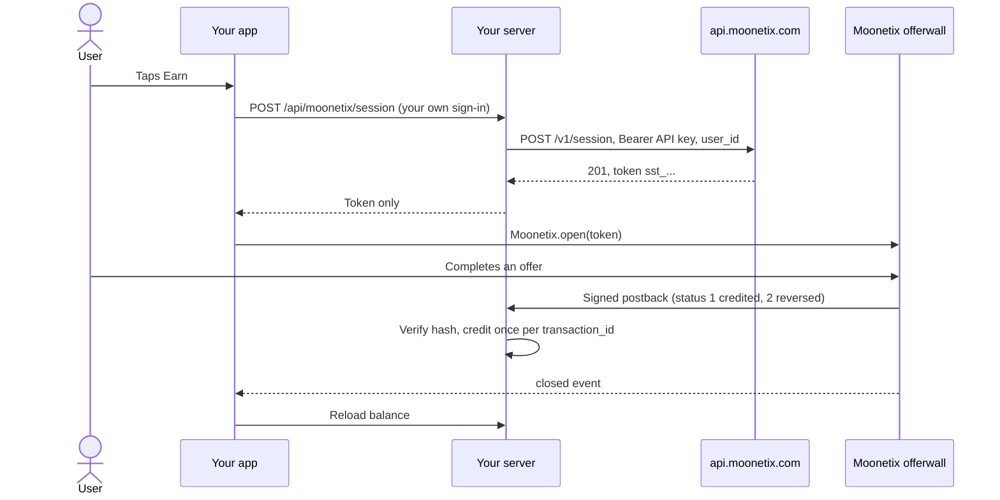

# Moonetix Offerwall for React Native

**Open the Moonetix offerwall in your React Native or Expo app with one call, from a single-use token your server creates.**

[](https://github.com/moonetix/moonetix-react-native/actions/workflows/ci.yml)
[](https://moonetix.com)
[](LICENSE)
[](https://docs.moonetix.com/react-native-sdk#install)
[](https://docs.moonetix.com/react-native-sdk)
[](https://moonetix.com/integrations/react-native)
[](src/index.ts)

This is the source of `@moonetix/react-native-offerwall` for [Moonetix](https://moonetix.com). The package is a TurboModule on top of the native Moonetix Android and iOS SDKs, with an Expo config plugin: the offerwall opens in a locked-down native screen, offer links go to the store or the browser, and a few events come back to your JavaScript. Moonetix is an affiliate network: your users earn your own currency by completing offers, and you earn per completed offer.

The source is the released 2.0.1 package. Install it from the Moonetix npm registry; this repository is for reading, auditing and building from source.

> To run it you need your Moonetix App ID and API key: see [Account](#account).

## Package at a glance

| Area | Details |
| --- | --- |
| **Architectures** | TurboModule for the New Architecture. Also runs on the old architecture (React Native 0.77 to 0.81). |
| **Expo** | Config plugin for `expo prebuild` and EAS Build. Expo Go cannot load it. |
| **Keys** | None in the app. It only holds a session token that works once and expires after 10 minutes. |
| **Build** | `npm run build` produces a `lib/` that is byte for byte the one in the published 2.0.1 package. TypeScript `strict`, Jest tests for the API, validation and the Expo plugin. |

## Sequence



## Quick start

### 1. Install

React Native 0.77 or newer, or Expo SDK 53 or newer. Your Android project needs Kotlin 2.0 or newer, which these versions use by default. The package is in the Moonetix npm registry. Add the registry for the `@moonetix` scope to the `.npmrc` file next to your `package.json`:

```
@moonetix:registry=https://moonetix.com/npm/
```

Then install the package and rebuild your app:

```bash
npm install @moonetix/react-native-offerwall
# or
yarn add @moonetix/react-native-offerwall
# Expo
npx expo install @moonetix/react-native-offerwall
```

npm, Yarn 1 and pnpm read `.npmrc`. With Yarn 2 or newer, add the scope to `.yarnrc.yml` instead:

```yaml
npmScopes:
  moonetix:
    npmRegistryServer: "https://moonetix.com/npm"
```

Prefer a file? Download [moonetix-react-native-offerwall-2.0.1.tgz](https://moonetix.com/downloads/moonetix-react-native-offerwall-2.0.1.tgz) and run `npm install ./moonetix-react-native-offerwall-2.0.1.tgz`.

- **Android:** the package adds the Moonetix Maven repository (only for the `com.moonetix` group) and the Android SDK to your Gradle build. If your `settings.gradle` sets `repositoriesMode` to `FAIL_ON_PROJECT_REPOS` or `PREFER_SETTINGS`, add `maven { url = uri("https://moonetix.com/maven") }` to the repositories there.
- **iOS:** the package brings the Moonetix iOS SDK with it, and CocoaPods links and embeds it. Run `pod install` in your `ios` folder.
- **Expo:** add `"plugins": ["@moonetix/react-native-offerwall"]` to the `expo` section of `app.json`, then run `npx expo prebuild` or start an EAS Build. Expo Go cannot load native code: there `Moonetix.isSupported` is `false` and `open` reports `UNSUPPORTED`. Use a development build to test.

### 2. Server side: the token endpoint

Creating a session needs the API key, so it happens on your server, never in JavaScript that ships in the bundle. One endpoint is enough: check the signed-in user, call `POST https://api.moonetix.com/v1/session` with that user's ID, and return `{ token }`. The [docs](https://docs.moonetix.com/android-sdk#token-endpoint) have it in Node.js, PHP and Python. [moonetix-ios-sdk/token-endpoint](https://github.com/moonetix/moonetix-ios-sdk/tree/main/token-endpoint) is a tested Node.js version that serves every Moonetix SDK.

The API key is on the API page of your dashboard and stays in the server environment (see [`.env.example`](.env.example)). A 403 from Moonetix (`app_not_live`, `user_blocked`) means the offerwall must not be shown. A 429 means more than 600 requests in a minute for the app: retry after `Retry-After`.

### 3. Open the offerwall

Call `init` once with the App ID from the Integration section. Then open the offerwall with a fresh token from your server.

```ts
import { Moonetix } from '@moonetix/react-native-offerwall';

Moonetix.init('YOUR_APP_ID');

// Asks YOUR server for a fresh token. Your server calls POST /v1/session with the API key.
async function fetchMoonetixToken(authToken: string): Promise<string> {
  const res = await fetch('https://your-server.example/api/moonetix/session', {
    method: 'POST',
    headers: { Authorization: `Bearer ${authToken}` },
  });
  if (!res.ok) {
    throw new Error(`Token request failed: HTTP ${res.status}`);
  }
  const { token } = (await res.json()) as { token: string };
  return token;
}

// When the user taps Earn:
Moonetix.open(await fetchMoonetixToken(authToken));
```

`open` never throws for offerwall problems. They arrive as events. Check `Moonetix.isSupported` and hide your Earn button where it is `false`, for example on web or in Expo Go.

`open(token, options)` takes optional `MoonetixOptions`:

| Option | Default | Effect |
| --- | --- | --- |
| `title` | Design section title | Top bar text |
| `toolbarColor` | Design section color | Any color string React Native understands, such as `'#004ABB'`. An invalid value logs a warning and falls back to the Design section. |
| `showLogo` | `true` | Show the Moonetix mark next to the title |

`Moonetix.version` is the package version, and `Moonetix.removeAllListeners(event?)` drops every listener at once.

## Events

`Moonetix.addListener` returns a subscription. Remove it when your screen goes away.

```ts
useEffect(() => {
  const closed = Moonetix.addListener('closed', refreshBalance);
  const failed = Moonetix.addListener('error', (error) => {
    console.warn(`${error.code}: ${error.message}`);
  });
  return () => {
    closed.remove();
    failed.remove();
  };
}, []);
```

| Event | When |
| --- | --- |
| `opened` | The offerwall finished loading its first page. |
| `closed` | The user closed the offerwall. Reload the user's balance from your server here. |
| `error` | A `MoonetixError` with a `code`: `NOT_INITIALIZED`, `INVALID_APP_ID`, `INVALID_TOKEN`, `TOKEN_EXPIRED_OR_USED`, `NETWORK`, `UNSUPPORTED` or `UNKNOWN`. Create a new session and try again. |

Errors from `init` and `open` arrive right after the call returns, so a listener you add in the same tick still receives them. An error with no `error` listener is logged with `console.warn`. Events are for your user interface only. Credit rewards from the signed postback on your server, never from an event.

## Troubleshooting

| What you see | Cause and fix |
| --- | --- |
| `UNSUPPORTED`: "The Moonetix native module is not in this build." | Rebuild the app after installing the package. Expo Go cannot load it: use a development build. |
| `INVALID_APP_ID` | The value in `init` is not the 24-character lowercase hex App ID. Passing the API key here is the usual mistake. |
| `INVALID_TOKEN` right after `open` | You passed the whole JSON answer or an empty string. Pass only the `token` field, which starts with `sst_`. |
| `INVALID_TOKEN` after the screen opened | The token was created with the API key of another app than the App ID in `init`. |
| `TOKEN_EXPIRED_OR_USED` | The token is older than 10 minutes or was opened twice. Request a new token on every tap. |
| Gradle cannot resolve `com.moonetix:offerwall` | Your `settings.gradle` blocks project repositories. Add `maven { url = uri("https://moonetix.com/maven") }` there. |
| A "VPN detected" page instead of offers | The device is on a VPN, a proxy or a cloud network. Test on a normal home or mobile connection. |

## Architecture

1. `Moonetix.init` and `Moonetix.open` check the App ID and token formats in JavaScript, then call the native module (`configure` and `open` in the codegen spec).
2. On Android, the module uses `com.moonetix:offerwall:2.0.1`. `android/build.gradle` adds the Moonetix Maven repository for the `com.moonetix` group only.
3. On iOS, the module uses `MoonetixOfferwall.xcframework` 2.0.1, linked and embedded by CocoaPods.
4. Both native SDKs keep only `wall.moonetix.com` pages inside the offerwall screen. Offer links open in the store or the browser.
5. Native events arrive through `NativeEventEmitter` and are passed to your listeners as `opened`, `closed` and `error`.
6. Rewards never pass through the app. Moonetix calls your postback URL, and your server credits the user.

| Path | Purpose |
| --- | --- |
| `src/Moonetix.ts` | Public API: `init`, `open`, `addListener`, `isSupported` |
| `src/types.ts`, `src/validation.ts`, `src/events.ts` | Error codes, options, input checks, event parsing |
| `src/NativeMoonetixOfferwall.ts` | Codegen spec of the TurboModule |
| `android/` | Java module on top of the Android SDK, new and old architecture |
| `ios/` | Objective-C++ module on top of the iOS SDK |
| `plugin/`, `app.plugin.js` | Expo config plugin that adds the Maven repository |
| `test/` | Jest tests with a mocked `react-native` and Gradle fixtures for the Expo plugin |
| `scripts/fetch-ios-sdk.sh` | Downloads and checks the iOS SDK binary for builds from this source |

## Security notes

- Create sessions on your server only. Never put the API key or the link hash salt in your app: anyone can read a bundle's files.
- Take the user ID from your own sign-in, never from the request. Otherwise anyone could open the offerwall as someone else.
- Return only the token to the app, and create a new one each time the user taps Earn.
- Credit rewards only from the signed server-to-server postback: verify the hash with a constant-time comparison first, credit each `transaction_id` once, and let status 2 take back only what was credited. See [offerwall-postback-handlers](https://github.com/moonetix/offerwall-postback-handlers).
- Reward users only for completed offers. Never reward joins, invites, likes, reviews or other engagement. Users must be 16 or older.

**Store privacy.** Declare User ID, Device ID, Coarse Location and Product Interaction for App Functionality, linked to the user and not used for tracking, in App Store Connect and in the Google Play Data safety form. See [App Store privacy details](https://docs.moonetix.com/ios-sdk#privacy).

## Working on the package

### From this source

```bash
npm ci
npm run typecheck    # tsc --noEmit over src and test
npx jest             # unit tests, React Native mocked
npm run build        # writes lib/
```

CI runs these four commands on Node 22. The tests mock `react-native`, so no device or simulator is needed.

The iOS SDK binary is not in this repository. To build the iOS side from this source, run `sh scripts/fetch-ios-sdk.sh` from the repository root first: it downloads `MoonetixOfferwall-2.0.1.xcframework.zip` from moonetix.com, checks its SHA-256 and unpacks it to `ios/Frameworks/`.

### In an app

1. Create a session for a test user from your server, and open it in a debug build on an Android phone, an iPhone or the iOS Simulator. A Metro reload does not add native code: rebuild the app after installing.
2. Check that the offerwall opens, that an offer opens in the store or the browser, and that back and close work.
3. In the dashboard, open Offerwalls, your offerwall, Integration, and click **Send a test postback**. You can also send one from the Postback page. Send status 1, then status 2 for the same user, and check that the balance goes up and back down.
4. Test on a normal home or mobile connection. On a VPN, a proxy or a cloud device the offerwall shows a block page instead of offers.

For error codes and fixes, see [Troubleshooting](https://docs.moonetix.com/react-native-sdk#troubleshooting) and [Testing](https://docs.moonetix.com/testing).

## Documentation and guides

- Docs: [React Native SDK](https://docs.moonetix.com/react-native-sdk), [Postbacks](https://docs.moonetix.com/postbacks), [Credits and reversals](https://docs.moonetix.com/credits-and-reversals), [Testing](https://docs.moonetix.com/testing)
- Academy: [How to Add an Offerwall to a React Native App](https://moonetix.com/academy/integrations/react-native-offerwall)
- Academy: [How to Test Your App Before It Goes Live](https://moonetix.com/academy/integrations/test-your-app-before-launch)
- Moonetix for React Native: [moonetix.com/integrations/react-native](https://moonetix.com/integrations/react-native)
- Moonetix for apps: [moonetix.com/industries/apps](https://moonetix.com/industries/apps)
- A complete app: [offerwall-react-native-example](https://github.com/moonetix/offerwall-react-native-example)

## Account

Sign up free at https://moonetix.com/register?from=github-moonetix-react-native. A person reviews each publisher application. When you are approved, add the app, set the currency name and rate, call `Moonetix.init` with the App ID, and put the API key in your server environment.

## More Moonetix examples

All on [github.com/moonetix](https://github.com/moonetix).

**SDKs**

- [moonetix-android-sdk](https://github.com/moonetix/moonetix-android-sdk): Android SDK source (Kotlin and Java)
- [moonetix-ios-sdk](https://github.com/moonetix/moonetix-ios-sdk): iOS SDK install guide, SwiftUI sample and token endpoint
- [moonetix-flutter](https://github.com/moonetix/moonetix-flutter): Flutter plugin source
- [moonetix-unity](https://github.com/moonetix/moonetix-unity): Unity plugin source

**Server side**

- [offerwall-postback-handlers](https://github.com/moonetix/offerwall-postback-handlers): postback handlers for common languages
- [offerwall-express](https://github.com/moonetix/offerwall-express), [offerwall-laravel](https://github.com/moonetix/offerwall-laravel), [offerwall-django](https://github.com/moonetix/offerwall-django)
- [offerwall-firebase-functions](https://github.com/moonetix/offerwall-firebase-functions), [offerwall-supabase](https://github.com/moonetix/offerwall-supabase)

**Web and apps**

- [offerwall-nextjs-starter](https://github.com/moonetix/offerwall-nextjs-starter), [offerwall-react-vite](https://github.com/moonetix/offerwall-react-vite), [offerwall-vue-nuxt](https://github.com/moonetix/offerwall-vue-nuxt)
- [rewards-site-starter](https://github.com/moonetix/rewards-site-starter), [moonetix-offerwall-wordpress](https://github.com/moonetix/moonetix-offerwall-wordpress)
- [offerwall-flutter-example](https://github.com/moonetix/offerwall-flutter-example), [offerwall-react-native-example](https://github.com/moonetix/offerwall-react-native-example)
- [offerwall-chrome-extension](https://github.com/moonetix/offerwall-chrome-extension), [offerwall-electron](https://github.com/moonetix/offerwall-electron)

**Games and communities**

- [offerwall-unity-example](https://github.com/moonetix/offerwall-unity-example), [offerwall-godot](https://github.com/moonetix/offerwall-godot), [offerwall-html5-game](https://github.com/moonetix/offerwall-html5-game)
- [telegram-mini-app-offerwall](https://github.com/moonetix/telegram-mini-app-offerwall), [discord-rewards-bot](https://github.com/moonetix/discord-rewards-bot)
- [awesome-offerwalls](https://github.com/moonetix/awesome-offerwalls): a curated list of offerwall resources

## License

Apache License 2.0. See [LICENSE](LICENSE).
